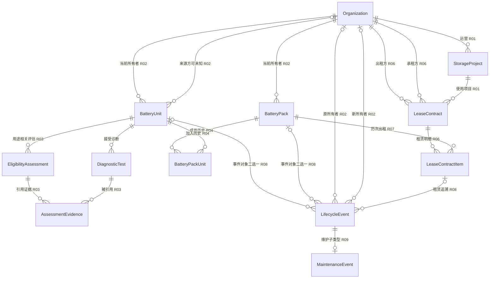

# 电池护照项目教师讨论材料

> 历史材料，归档于 2026-11-06。保留当时的研究、草案和来源；第四板块当前入口为[组包与维护需求说明](../../2026-11-06_组包与维护需求说明.md)。本文不构成教师逐项批准记录。10 月 14 日全组草案的其他板块也仍需各自评审。

**日期：2026年10月14日｜讨论目标：评审12个候选实体的 ER/EER 草图，确认范围、关系和关键业务规则。**

**状态：推荐方案／待教师确认。** 本次更新增加 AssessmentEvidence，并提出 MaintenanceEvent 作为 LifecycleEvent 子类型的设计；图中基数和规则均为建议，不代表教师已批准或数据库已实现。

## 项目范围

面向小型储能运营商和梯次利用企业，使用 PostgreSQL 建立关系型数据库。项目中的“电池护照”记录电池单元身份、诊断证据、资格评估、组包与租赁关系，以及生命周期事件。

- **纳入**：登记、诊断摘要与质量标记、资格记录、组包、项目分配、租赁、维护、返还、转移和处置留痕。
- **范围外**：原材料溯源、实时车载遥测、区块链、真实支付与 ROI、完整法规合规引擎、机器学习预测。
- **数据方案**：公开电芯实验曲线、派生摘要和合成业务记录分别标注来源；当前克隆不含原始 CSV，需重新获取并复核。资格结论仅用于课堂工作流演示。

## 业务流程

组织与电池单元登记 → 导入诊断并标记异常 → 记录用途相关资格 → 组包并检查成员资格 → 分配储能项目并建立租赁 → 维护、返还、转移或处置并保留历史。

## 候选实体

| 类别 | 候选实体 | 主要职责 |
| --- | --- | --- |
| 资产 | Organization、BatteryUnit | 组织、单元身份和来源 |
| 诊断与评估 | DiagnosticTest、EligibilityAssessment、AssessmentEvidence | 诊断摘要、评估决定及其多份证据 |
| 组包 | BatteryPack、BatteryPackUnit | 电池组及单元组成关系 |
| 项目与租赁 | StorageProject、LeaseContract、LeaseContractItem | 项目、合同和租赁资产明细 |
| 运维与历史 | LifecycleEvent、MaintenanceEvent | 通用事件及维护子类型详情 |

共 **12个核心候选实体**。新增 AssessmentEvidence 将测试与评估的多对多关系映射为两条一对多关系；测量点另置技术表 DiagnosticMeasurement，不计入12个核心实体。

## ER/EER 关系草图（推荐方案）

[查看可缩放的静态关系图](2026-10-14_ER-EER.svg)。下方保留 Mermaid 源图，便于继续编辑；导出的 HTML／PDF 直接嵌入静态图，无需在线加载。

图例：`||` = 恰好1；`o|`／`|o` = 0或1；`o{` = 0到多；`|{` = 1到多。每端符号表示另一端一条记录可关联的数量。图中的可选性允许登记／草稿状态；正式评估、可出租组、已确认合同的最低数量另由 R03、R04、R06 限制。**图上所有关系均待教师评审**；`Rxx` 对应下方待确认规则。线型采用 Mermaid 的关系表示法，不用于区分审批状态。

三组历史／证据多对多关系：**电池组 ↔ 单元**经 BatteryPackUnit；**合同 ↔ 电池组**经 LeaseContractItem；**资格评估 ↔ 诊断测试**经 AssessmentEvidence。多对多不表示可以同时重复组包或重叠出租。

**EER 子类型：MaintenanceEvent ISA LifecycleEvent，属于部分特化。** 每条维护详情必须有一个父事件，但并非每个生命周期事件都是维护。两条资产到 LifecycleEvent 的可选关系受 XOR 约束：每条事件必须且只能选择一个单元或一个组。当前草案只允许组级维护，因此组与维护详情通过父事件间接关联。

### 基数、可选性与建议外键

| 关系／角色 | 对一条子记录的要求 | 对一个父对象的数量 | 建议映射／条件 |
| --- | --- | --- | --- |
| Organization → StorageProject：运营方 | 恰好1个组织，必选 | 0..N个项目 | StorageProject.operator_org_id；R01 |
| Organization → BatteryUnit：所有者 | 恰好1个组织，必选 | 0..N个单元 | BatteryUnit.current_owner_org_id；R02 |
| Organization → BatteryUnit：来源方 | 0..1个组织，可未知 | 0..N个单元 | BatteryUnit.source_org_id 可空；数据出处另记；R02 |
| Organization → BatteryPack：所有者 | 恰好1个组织，必选 | 0..N个组 | BatteryPack.current_owner_org_id；R02 |
| Organization → LeaseContract：出租方 | 恰好1个组织，必选 | 0..N份合同 | LeaseContract.lessor_org_id；R06 |
| Organization → LeaseContract：承租方 | 恰好1个组织，必选 | 0..N份合同 | LeaseContract.lessee_org_id；R06 |
| StorageProject → LeaseContract | 恰好1个项目，必选 | 0..N份合同 | LeaseContract.project_id；R01 |
| BatteryUnit → DiagnosticTest | 恰好1个单元，必选 | 0..N次测试 | DiagnosticTest.battery_unit_id |
| BatteryUnit → EligibilityAssessment | 恰好1个单元，必选 | 0..N份评估 | EligibilityAssessment.battery_unit_id；用途为评估属性；R03 |
| EligibilityAssessment → AssessmentEvidence | 恰好1份评估，必选 | 草稿0..N；正式1..N | assessment_id；R03 |
| DiagnosticTest → AssessmentEvidence | 恰好1次测试，必选 | 0..N次被引用 | diagnostic_test_id；两外键组成复合主键；R03 |
| BatteryPack → BatteryPackUnit | 恰好1个组，必选 | 新建0..N；可出租1..N | pack_id、unit_id、加入／移出时间；R04 |
| BatteryUnit → BatteryPackUnit | 恰好1个单元，必选 | 历史0..N；任一时刻0..1 | 同一单元可先后加入不同组；R04 |
| LeaseContract → LeaseContractItem | 恰好1份合同，必选 | 草稿0..N；已确认1..N | contract_id；R06 |
| BatteryPack → LeaseContractItem | 恰好1个组，必选 | 历史0..N | pack_id、租期开始／结束；R07 |
| BatteryUnit → LifecycleEvent | 对单元型事件恰好1；其他事件0 | 0..N条事件 | battery_unit_id 可空，受 XOR 约束；R08 |
| BatteryPack → LifecycleEvent | 对组型事件恰好1；其他事件0 | 0..N条事件 | battery_pack_id 可空，受 XOR 约束；R08 |
| LifecycleEvent → MaintenanceEvent | 每条维护恰好1个父事件，必选 | 普通事件0；维护事件恰好1 | event_id 为维护表主键兼外键；R09 |
| Organization → LifecycleEvent：原／新所有者 | 普通事件每个角色0..1；所有权转移时每个角色恰好1 | 每个角色0..N条事件 | from_owner_org_id、to_owner_org_id；R02 |
| LeaseContractItem → LifecycleEvent | 普通事件0..1；租赁相关事件恰好1 | 0..N条事件 | lease_contract_item_id；R08 |

## 推荐方案及原因

1. **一个项目对应一个运营组织（R01）。** 一个组织可运营多个项目，合同承租方必须等于项目运营方。区分公司与实际使用场景，暂不引入联合运营或代租。
2. **组织角色分开命名（R02、R06）。** 分别记录单元来源方、资产当前所有者、合同出租方与承租方，避免一个 organization_id 同时承担多种含义。来源方允许未知；资产所有者在演示业务登记时必填。租赁不改变所有权；所有权转移才更新所有者并追加转移事件。
3. **一份评估可综合多次测试（R03）。** 新增 AssessmentEvidence，使测试证据可被不同用途／时间的评估复用。正式评估至少引用一次测试，所有证据必须属于被评估单元；不能根据当前单元状态猜测历史评估依据。
4. **成员关系保留时间区间（R04、R05）。** BatteryPackUnit 保存加入和移出时间，以支持同一单元先后加入不同组，并追溯事件发生时的组内成员。组包时组与成员所有者一致；租期内冻结组成。组成变化后重新检查资格。
5. **合同头与租赁明细分开（R06、R07）。** 每份合同有一个出租方、承租方和项目；多个电池组通过明细列出，各明细保存租期。确认时检查归属、资格和租期冲突，支持并发出租冲突演示。
6. **事件对象采用两个可选外键加 XOR（R08）。** 每条 LifecycleEvent 只指向一个单元或一个组；具体外键可保证目标存在。暂不采用 asset_type + asset_id 的通用指针。整组事件可经当时成员关系追溯，不机械复制成每个成员的事件。
7. **维护是通用事件的子类型（R09）。** LifecycleEvent 保存时间、资产、事件类型、记录人／角色和来源；MaintenanceEvent 只保存故障、措施和结果，以 event_id 主键兼外键继承身份。MVP 仅支持组级维护，避免重复存储时间和目标资产，也可展示 EER 部分特化。
8. **需要换单元时先结束原租赁（R10）。** 先结束相关租赁明细并记录返还，再调整组成、复核资格、建立新租期。首次实现不加入“暂停租赁后仍可改组”的第二套流程，便于维护租期内冻结组成规则。

## 待老师确认的规则（建议草案）

| 编号 | 推荐规则／需要确认的边界 | 为什么需要确认 |
| --- | --- | --- |
| R01 | 每个项目恰好一个运营组织；合同承租方等于运营方，不支持代租／联合运营。 | 决定组织、项目与合同的基数和跨表一致性。 |
| R02 | 来源组织可未知，当前所有者必填；租赁不转移所有权。组与成员所有者一致；组的所有权转移包含当时成员，在同一事务中记录各资产转移并更新当前所有者。 | 确认来源、所有权与使用权含义；避免组与成员归属冲突。转移事件需记录原／新所有者外键，组织作为每种角色可对应0..N事件；目标资产仍受 R08 约束。 |
| R03 | 单元级、用途相关评估；正式结论至少一份同单元证据；增加 AssessmentEvidence，使核心实体变为12个。 | 确认是否允许多证据、多用途及评估版本留痕。 |
| R04 | 成员历史为多对多；单元成员时间区间不得重叠；可出租组至少一个成员。 | 确定时间约束、空组登记和最低成员数量。 |
| R05 | 只允许组内成员对项目所需用途均 eligible 的组出租；conditional 不直接出租；确认及租期开始前重新检查。 | 阈值、评估有效期和结论冲突处理尚未确定；组包／出租规则仅作课堂演示。 |
| R06 | 草稿合同可无明细，已确认合同至少一条；一个合同对应一个出租方、承租方和项目；出租方拥有所有明细中的组。 | 确认草稿可选性、合同归属和明细租期的管理方式。 |
| R07 | 同一组的已确认有效租期不得重叠；采用半开区间 [开始, 结束)，相接不算重叠。取消或提前结束应明确释放的区间。 | 确定参与冲突检查的状态和并发处理语义。 |
| R08 | 每条事件恰好指向单元或组之一；返还／出租等涉及租赁的事件另可关联具体 LeaseContractItem。普通事件允许无明细，租赁相关事件必须有一条对应明细且资产一致。 | 确定允许的事件类型及与合同的追溯。明细与事件为1:N，事件侧0..1。 |
| R09 | MaintenanceEvent 为 LifecycleEvent 维护子类型；父事件 type=maintenance 当且仅当有维护详情；维护对象仅电池组。 | 确认 EER 子类型、必有详情和资产范围；主键／外键本身不能完整保证类型和详情匹配。 |
| R10 | 需要换单元时先结束相关租赁并返还，再改组、复核和建立新租期；其他不改组成的维护可在租期内发生。 | 确认维护期间的租赁、可用状态及成员冻结流程。 |
| R11 | 创建维护父事件与详情、正式化评估／合同、组包、租赁确认和所有权转移需原子提交；跨表检查另设计约束触发器或受控事务。 | 基数图不保证最低明细数、XOR之外的类型匹配和证据同单元等规则；不能仅靠外键实现。 |
| R12 | 公开实验、派生诊断、合成组织与业务关系分别留来源；公开单元关联演示所有者不代表真实企业所有权。评估人先作为记录属性，暂不新增用户实体。 | 确认混合来源记录、课程证据边界和实体数量。 |

### 图外业务检查与实现边界

- **出租资格没有额外的组级评估实体。** 经 BatteryPackUnit 找到当前成员，再查询与项目用途一致的正式评估；用途可先作为 StorageProject.required_use 和 EligibilityAssessment.intended_use 属性。
- **主图中的最小数量是状态相关的。** 刚登记的单元可以没有诊断和评估，空组及无明细合同可以作为草稿，但不得直接出租／确认。图不能代替状态转换检查。
- **补充追溯关系不增加实体。** R02 的 LifecycleEvent.from_owner_org_id／to_owner_org_id 是可选组织外键，转移事件必须同时填写；R08 的 lease_contract_item_id 为可选明细外键，租赁相关事件必须填写。具体事件字段与一致性待教师确认。
- **证据、成员和合同明细均需键。** AssessmentEvidence 可用两外键复合主键；BatteryPackUnit 建议独立成员记录键，以允许同一单元后来重新加入同一组；LeaseContractItem 使用明细键，以便事件准确引用一次租赁。
- **教师确认后再形成实施决策。** 当前只更新讨论材料与上下文，不表示已经完成 DDL、导入、约束或测试。

## 讨论议程

| 需要老师确认 | 我们建议的方案 |
| --- | --- |
| 范围和数据方案是否满足课程要求？ | 采用上述12个核心实体和测量技术表；公开电芯实验数据配合合成业务记录，先完成一个完整业务流程。 |
| 资格评估针对什么对象，怎样形成结论？ | 先评估 BatteryUnit，保留证据、用途、评估人、时间和理由；由测试人员给出课堂演示结论。conditional 暂不直接出租，需进一步审批。 |
| 组包层级和可出租条件如何定义？ | 采用“单元→电池组”两层；单元不能同时属于多个当前组。租期内冻结组成；组内成员满足已确认条件才允许出租，组成变更后重新检查。 |
| 租赁对象、合同关系和并发约束如何定义？ | 只租电池组；一份合同对应一个承租组织和一个储能项目，可包含多个组。同一组的已确认租期不得重叠，并演示两人同时租赁时的冲突处理。 |

## 会后交付

逐项记录 R01–R12 的“接受／调整／暂缓”结果；根据本页草图修订正式 ER/EER 图与业务规则表，再形成数据字典、3NF 关系映射及 PostgreSQL 约束方案。

依据：[项目范围](../../PROJECT_CONTEXT.md)、[已有决策](../../DECISIONS.md)、[下一步计划](../../NEXT.md)、[历史数据审计](../../DATA_AUDIT.md)。本页新增的业务规则为讨论草案。
