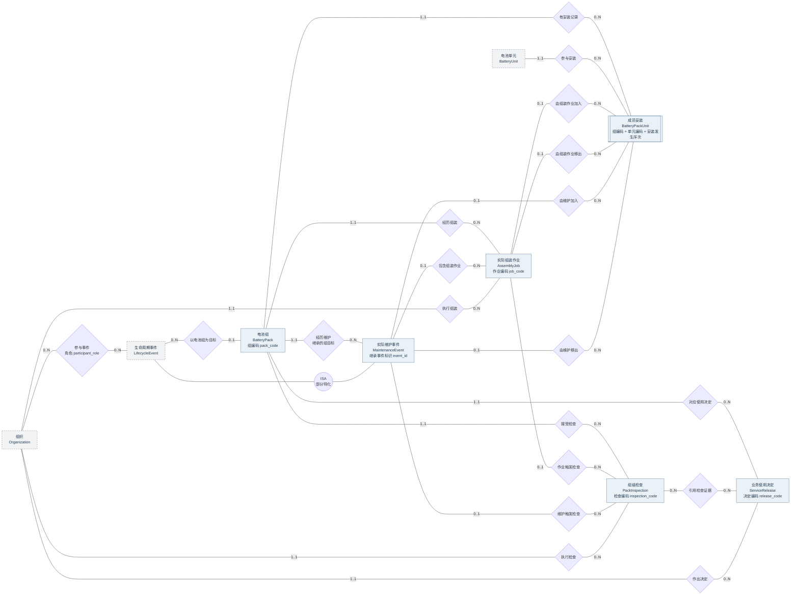
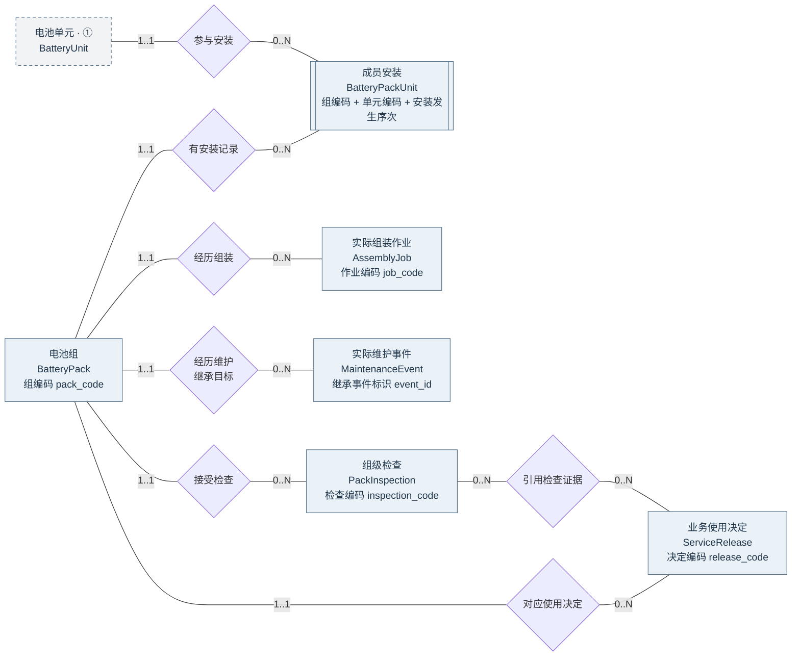
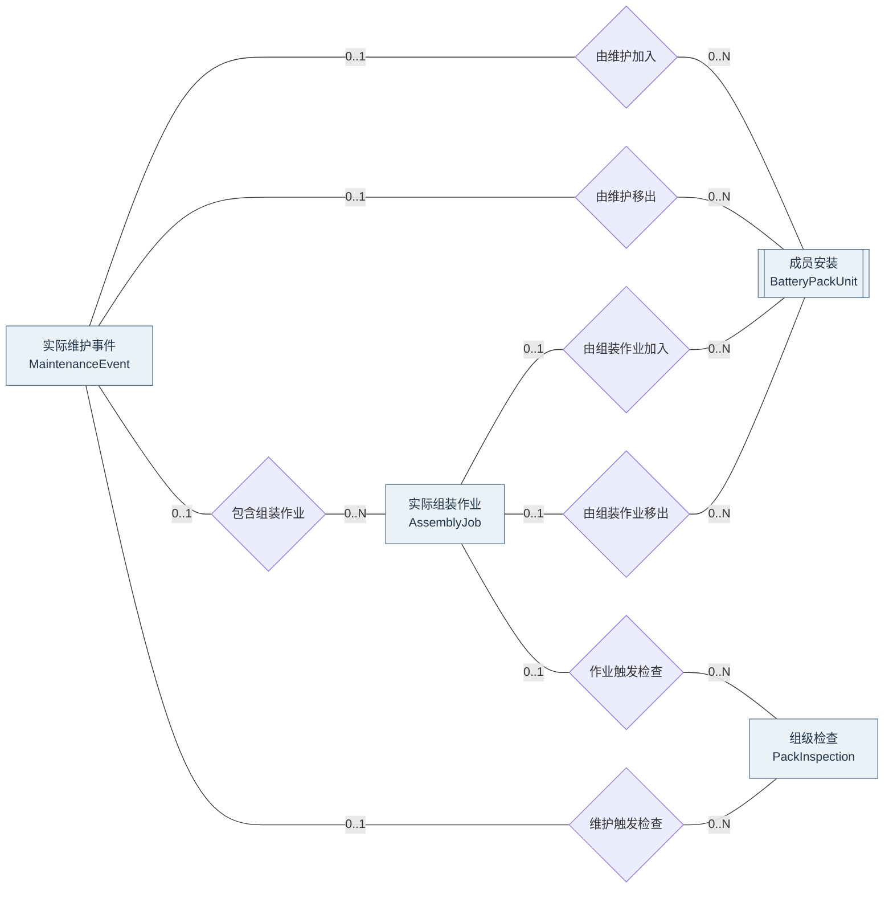
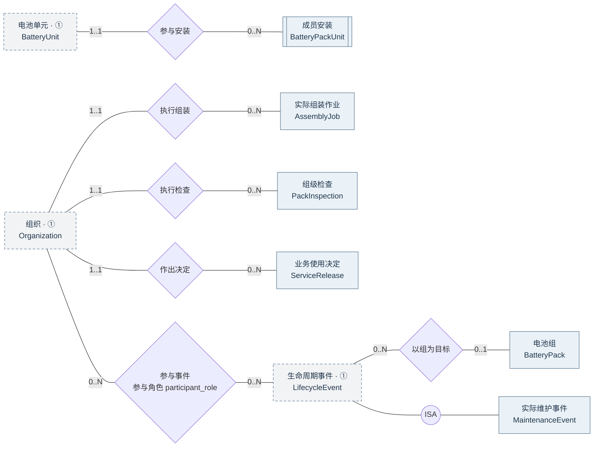

# 第四板块组包与维护合图工作稿

## 完整 ER 图（合图入口）

在 Obsidian 阅读视图中打开这张总图。浅蓝框为第四板块的 6 个实体，灰色虚线框为共享的 3 个实体。合图时按英文标识复用共享实体定义。菱形两侧的基数分别标在对应实体一侧，固定对端一个实例即可读取。

图中「经历维护」展示通过 ISA 继承得到的组目标。合图时用 `LifecycleEvent` 的目标联系承载这一关系。第 4 节记录各板块的接口和讨论结论。

## 1 核心实体与关系

浅蓝框为第四板块对象，灰色虚线框为共享对象，双侧线框为关联实体，菱形为联系。`0..N` 表示零到多，`0..1` 表示零或一，`1..1` 表示恰好一。一个电池组可有多次历史安装，每次安装对应一个组和一个单元。

成员安装的安装发生序次为 `occurrence_no`。连同组编码 `pack_code` 和单元编码 `unit_code`，它区分同组同单元的多次安装。组级检查记录实际受检组成与判定依据，业务使用决定记录对指定用途和组成作出的允许、拒绝或暂缓。允许使用须引用所需的同组、同组成检查，证据缺失而拒绝或暂缓时须记录理由。[完整中文属性字典](../../2026-11-06_第四板块ER建模说明.md#3-属性字典)

## 2 成员变化与检查触发

- **加入和移出各自选择一个已知主要来源。** 来源未知时记录缺失理由，尚未移出的安装没有移出来源。维护内的重组实际执行变更时，安装指向重组，再经重组追溯维护。安装、来源及所属维护的组一致。
- **每次检查至多有一个主要触发来源。** 触发与检查针对同一组。定期检查可没有执行触发。
- **以半开区间 `[joined_at, removed_at)` 记录安装。** 同刻变化用业务顺序区分。同一单元的有效安装不可重叠，同组同位置也不可重叠。检查和决定按 `composition_as_of` 与必要的 `composition_order` 还原组成，同时保留当时适用的依据。换件后需重新核对旧决定的适用性。

## 3 共享实体与维护继承

维护是生命周期事件的部分特化，继承 `event_id`、目标、时间、来源和参与角色。维护要求恰有一个电池组目标及一个主要执行组织，其他生命周期事件的目标与全局特化规则由①统一。组织拥有组的联系仍待①④定基数。

## 4 晚间合图对接表

逐行确认“对方提供哪条记录、④用什么标识引用、什么时候使用”。达成一致后，在最后一栏记下确认或调整结果与主责板块，再改对应代码块。候选接口的基数留给双方确认。

| 板块 | ④需要对方提供 | ④交给对方 | 今晚要定的接口 | 会议结论 |
|---|---|---|---|---|
| ① 资产登记与来源追溯 | `BatteryUnit` 的单元身份，`Organization` 的组织与角色，`LifecycleEvent` 的身份、目标和时间 | `BatteryPack` 的组身份需求、成员变更与维护事件需求 | 对齐组与单元标识、换件后组身份延续、所有权基数。确认父事件如何指向组、维护继承哪些角色和时间。对应图 1、图 3，Q03、Q04、Q07。 | 待确认 |
| ② 诊断测试与数据质量 | `DiagnosticTest` 的成员诊断证据，方法版本、指标单位和质量标记 | `PackInspection` 的初装与修后检查、组成基准和报告引用 | 确认组级检查是否复用检查框架、检查明细粒度及证据引用标识。对应图 1 的 `PackInspection`，Q06。 | 待确认 |
| ③ 使用资格评估 | `EligibilityAssessment`、`AssessmentEvidence`、用途与有效条件 | 安装时实际成员、组使用决定所采用的用途与组成 | 确认采用的资格证据挂在安装还是作业、如何引用，以及条件资格和换件复核规则。对应图 2 的 `BatteryPackUnit` / `AssemblyJob`，Q02、Q05、Q08。 | 待确认 |
| ⑤ 储能项目与租赁 | `StorageProject`、租赁合同与明细、租期占用、返还及用途 | 组身份与组成历史、维护、组级检查和 `ServiceRelease` | 确认租赁明细引用哪个组标识、使用决定按什么用途和时点查询，以及租期内维护或改组的先后顺序。对应图 1 的 `BatteryPack` / `ServiceRelease`，Q02、Q08、Q09。 | 待确认 |

用同一条样例检查各方是否能接起来。①给出 U1、U2、U3 的身份，②③给出诊断和资格证据，④用 J1 初装 P1 并记录 I1、R1，⑤关联租赁记录。维护 M1 下的 J2 将 U1 换为 U3 后，检查 I2 和决定 R2 应对应新组成。现场核对租期如何处理，以及 R1 是否仍能还原旧组成。[样例和完整待确认清单](../../2026-11-06_第四板块ER建模说明.md#6-简短合成时间线核验)
